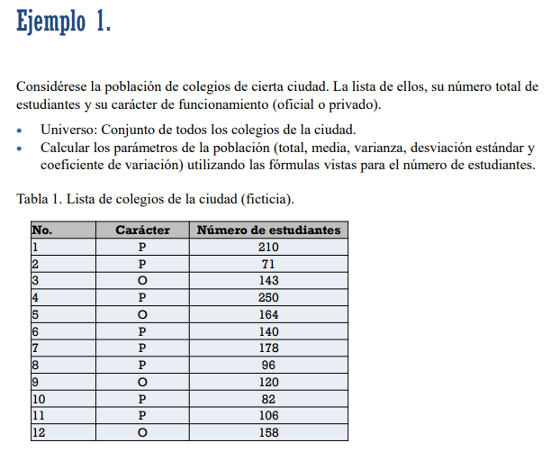

# Muestreo

- En las investigaciones por muestreo el objetivo principal es estimar los parámetros
de la población a partir de una muestra seleccionada.
- La muestra seleccionada puede ser una muestra probabilística o no probabilística.
- En las muestras probabilísticas cada elemento de la población tiene una
probabilidad conocida, diferente de cero, de formar parte de la muestra, lo que
permite que se hagan estimaciones válidas a partir de ella.

## La Poblacion y la Muestra

- La población (o universo o población objetivo) es el conjunto de individuos a los
que se van a extrapolar los resultados de la encuesta.
- Los miembros individuales de la población cuyas características se van a medir se
denominan unidades elementales o elementos de la población.
- Si realizamos una encuesta por muestreo para estimar el número de personas que
viven en Ibagué y que nunca han visitado a un dentista, el universo está formado por
todas las personas que viven en Ibagué, y cada persona que vive en Ibagué es una
unidad elemental o elemento.
- Si realizamos una encuesta por muestreo de las historias clínicas de los hospitales
con el fin de estimar el número de altas hospitalarias en un año determinado que
tienen diagnósticos específicos, cada alta hospitalaria que se produce durante el
año es un elemento, y la totalidad de dichas altas constituye el universo o población.

## Marco Muestral

- Cualquier material o mecanismo (listas, mapas, registros, etc.) que permita delimitar o
identificar en forma apropiada los elementos de una población, recibe el nombre de
marco muestral.
Algunas propiedades que un marco debe poseer son (según Sarndal, 1992):

1. Las unidades en el marco deben identificarse a través de un código, de 1 hasta 𝑁𝑀 ,
donde 𝑁𝑀 es el número de unidades de muestreo.
2. Cada unidad debe tener factibilidad de ser hallada si es seleccionada en la muestra.
3. El marco debe estar organizado de una forma sistemática (puede ser por tamaño o
ubicación geográfica).
4. El marco debe tener un vector de información adicional para cada unidad. Esta
información puede ser usada en la construcción de estimadores que involucren
variables auxiliares.
5. Todo elemento de la población de interés debe estar presente solamente una vez en
el marco.
6. Ningún elemento ajeno a la población de interés debe estar presente en el marco

- Población objetivo: población que se desea
investigar.
- Población marco = Marco muestral): lista de
unidades de muestreo de entre las que se
selecciona la muestra.
- Población investigada: población que realmente
es objetivo de estudio (no incluye las ausencias,
los errores en la inclusión, las negativas a
colaborar o la inaccesibilidad a algunas unidades).
- Muestra: conjunto de unidades de muestreo
seleccionadas de un marco o de varios marcos, de
los que se toma información en el proceso de
muestreo. Subconjunto de la población.
- Unidad vacía: unidad erróneamente incluida en el
marco y que no pertenece a la población objetivo
aunque esté relacionada con ella.
- Unidad extraña: unidad que no es realmente del
marco y que no tiene relación de ningún tipo con
la población objetivo.

Población muestrada (= Muestra): elementos de la población que componen la muestra. No siempre coincide
con la población objetivo.

- Unidad de observación: objeto sobre el cual se realiza una medición. Unidad básica de observación, a veces
llamada elemento.
- Unidad de muestreo: unidad donde realizamos la muestra. No siempre coincide con con las unidades de
observación. Ejemplo: cuando se seleccionan familias como unidades de muestreo y las unidades de observación
son los individuos que viven en una famili

## Muestra y Marco Muestral

En caso de requerir diferentes marcos muestrales, porque el estudio o investigación se
lleve a cabo en diferentes etapas, las unidades muestrales recibiran el nombre de
unidades primarias de muestreo, secundarias, etc.; dependiendo de la etapa respectiva
en que sea seleccionada.

Ejemplo: selección de municipios del país, de sectores dentro de los municipios, de
manzanas dentro de los sectores y de hogares dentro de las manzanas.

## Parametros Poblacionales

Entre los objetivos de realizar un muestreo se incluye la estimación de ciertos valores de la
distribución de una variable o característica específica en una población. Estos valores para una
población se denominan parámetros, y para una población determinada, un parámetro es constante.

Dada una población, para una variable numérica X, donde N es el tamaño de la población, se define:

- El total poblacional $X = \sum_{i=1}^{N} X_i$
- La media poblacional: $\bar{X} = \frac{\sum_{i=1}^{N} X_i}{N}$
- La varianza poblacional: $\sigma_X^2 = \frac{\sum_{i=1}^{N} (X_i - \bar{X})^2}{N}$
- La desviación estándar poblacional: $\sigma_X = \sqrt{\frac{\sum_{i=1}^{N} (X_i - \bar{X})^2}{N}}$
- El coeficiente de variación poblacional: $CV = \frac{\sigma_X}{\bar{X}}$

### Variable Dicotopicas

Para el caso de las variables dicotómicas, se utiliza la definición de variable
indicadora, se define:

El número de elementos que poseen el atributo deseado en la población es el mismo
total poblacional. 

$$
 A = \sum_{i=1}^{N} X_i
$$

- **La proporción poblacional** (es la misma media poblacional para variables dicotómicas )
- $\bar{X} = \frac{A}{N} = \frac{\sum_{i=1}^{N} X_i}{N}$
- **La varianza poblacional:** $\sigma_X^2 = P_X (1 - P_X)$
- **La desviación estándar poblacional:** $\sigma_X = \sqrt{P_X (1 - P_X)}$
- **El coeficiente de variación poblacional:** $CV = \left(\frac{1 - P_X}{P_X}\right)^{1/2} = \sqrt{\frac{1 - P_X}{P_X}}$

## Estadisticos

Un estadístico es una función de los valores muestrales (valores obtenidos al
registrar las mediciones de los elementos seleccionados en la muestra), siendo
por tanto una variable aleatoria ya que su valor cambia de una muestra a
otra muestra con los resultados del proceso de selección aleatoria.

- Los estadísticos pueden ser calculados con fines descriptivos o para estimar los
parámetros poblacionales (estimador).
- Al valor que toma un estimador en una muestra específica se le denomina
estimación.

Un estadístico es una variable aleatoria y será denotado por una letra mayúscula 𝑿ഥ (antes de
seleccionar una muestra o realizar un experimento), el valor calculado u observado de este
estadístico es ഥ𝒙 (valores en la muestra).

A continuación se definen los principales estadísticos usados para la estimación de
parámetros en el caso de variables cuantitativas.

Dada una muestra, para una variable Y en la muestra, donde n es el tamaño de la
muestra, se define:

- **El total muestral:** $y = \sum_{i=1}^{n} y_i$
- **La media muestral:** $\bar{y} = \frac{\sum_{i=1}^{n} y_i}{n}$
- **La desviación estándar muestral:** $s = \sqrt{s^2}$
- **El coeficiente de variación muestral:** $cv = \frac{s}{\bar{y}}$

## Ejemplo Estimacion Parametros y Proporcion

[Muestreo Distribuciones Muestrales](Muestreo/Muestreo%20Distribuciones%20Muestrales%2040bf5d16cacb80f9be2fc5ab8765b613.md)

[Muestreo Aleatoria Simple](Muestreo/Muestreo%20Aleatoria%20Simple%20409f5d16cacb809e8c80d60ddd635727.md)

[Muestreo Aleatorio Estratificado](Muestreo/Muestreo%20Aleatorio%20Estratificado%20409f5d16cacb800bac45d8d006cbc205.md)